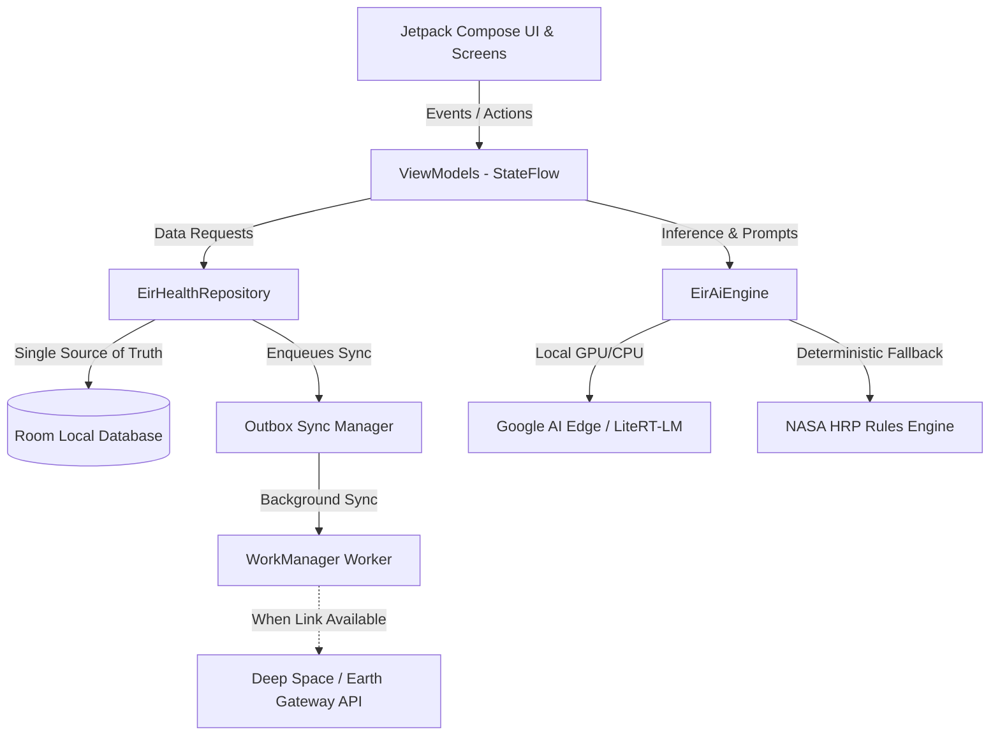

# 🚀 EIR (SOLIS) — NASA Space Apps Challenge

[](https://developer.android.com/)
[](https://kotlinlang.org/)
[](https://developer.android.com/jetpack/compose)
[](https://ai.google.dev/edge)
[](https://developer.android.com/training/data-storage/room)
[](https://github.com/Caryuter/nasa-space-app-challenge-eir-mobile/releases/latest)

> **EIR** is an autonomous medical and emotional health companion designed for deep space exploration missions (Moon & Mars), where severe communication latencies (up to 22 minutes each way) make real-time telemedicine from Earth impossible.

EIR provides astronauts with multimodal biometric monitoring, preventive health triage, habit tracking, and conversational AI support **100% offline on-device**, with zero dependency on external cloud infrastructure.

---

## 📱 Download APK

You can download the pre-compiled, signed APK directly from the **GitHub Releases**:

📥 **[Download Eir-v1.0.0.apk](https://github.com/Caryuter/nasa-space-app-challenge-eir-mobile/releases/latest)**

*System Requirements: Android 8.0 (API level 26) or higher.*

---

## ✨ Key Features

### 1. 🧬 Multimodal Biometric Capture & Mandatory Daily Checkup (4 Steps)
A sequential, guided flow designed to collect non-invasive biomarkers utilizing standard smartphone hardware:
- **Step 1 — Real-time Facial Scan (CameraX):** Front camera preview with an anatomical canvas guide to analyze visual signs of microgravity fluid shifts (cephalic fluid redistribution, periorbital edema, and ocular fatigue).
- **Step 2 — Guided Voice Acoustic Test (AudioRecord):** Astronauts read an operational calibration sentence to assess respiratory pauses, vocal stability, and fatigue locally.
- **Step 3 — Tactile Vitals Logging:** Intuitive stepper controls (`- / +`) pre-filled with the latest logs for heart rate, blood pressure, body temperature, and sleep duration.
- **Step 4 — 2D Emotional & Energy Circumplex:** Interactive 2D tactile grid based on Russell's Circumplex Model (*Energy* on the Y-axis vs. *Valence/Mood* on the X-axis) accompanied by operational feeling chips.

### 2. 🤖 On-Device Conversational AI Copilot (Google AI Edge / LiteRT-LM)
- Local Large Language Model (LLM) inference running on-device GPU/CPU using **Google AI Edge LiteRT-LM**.
- **Local Context Injection:** The copilot dynamically ingests the crew member's latest vitals, sleep, hydration, and emotional state into prompt context.
- **Deterministic NASA HRP Fallback:** Built-in rules and clinical guidance based on the *NASA Human Research Program (HRP)* ensure sub-500ms deterministic answers even without network connectivity or if neural weights are not yet loaded.
- Quick actions: *"Explain this simpler"* and *"Give me step-by-step action items"*.

### 3. 🧍 Interactive Anatomical Body Scan
- Interactive human body visualization (anterior and posterior views).
- Zone-based symptom logging (*Head, Chest, Abdomen, Limbs*).
- Integrated camera capture to document localized physical symptoms or skin irritations over time.

### 4. 🍎 Habits, Nutrition & Resistive Exercise
- Calibrated daily water hydration tracker.
- Meal logging and calorie monitoring for space mission diets.
- Timed tracking for resistive exercise routines, vital for mitigating bone mineral density loss and muscle atrophy in microgravity.

### 5. 📖 Emotional Journal & Responsive Companion Mascot
- Mission log for personal reflections, notes, and psychological monitoring.
- **Companion Mascot:** Emotionally reactive visual mascot adapting animations and microcopy based on the astronaut's real-time physical and mental status.
- Sparkline visual trendlines showcasing historical well-being across mission Sol days.

### 6. 🚨 Emergency SOS Protocol Mode
- High-contrast red interface engineered for high-stress and panic scenarios.
- **Single Giant Instruction per Screen:** Zero distractions, minimal cognitive load.
- **Medical Kit Visual Referencing:** Translates complex medical gear to intuitive visual cues (e.g., *"Take the blue pouch with the white cross and attach the clamp to your index finger"*).
- **Hands-Free Text-To-Speech (TTS):** Automatically reads each emergency step aloud.

---

## 🎨 Design Philosophy: "Zero Medical Jargon"

Following NASA human factors and habitability recommendations, EIR reduces stress by replacing intimidating clinical acronyms with clear, everyday analogies:
- **Heart Rhythm** *(instead of Heart Rate / BPM)*
- **Body Battery** *(instead of Heart Rate Variability / HRV)*
- **Blood Oxygen** *(instead of SpO2)*
- **Circulation Pressure** *(instead of Blood Pressure / mmHg)*

Fully supports dynamic bilingual switching between **English** and **Spanish**.

---

## 🏗️ Technical Architecture

EIR is built following an **Offline-First** reactive architecture, where the local SQLite database via Room serves as the **Single Source of Truth (SSOT)**:



### Technology Stack
| Layer / Feature | Library / Technology |
| :--- | :--- |
| **Language** | Kotlin 2.0+ (Coroutines, Flow, StateFlow) |
| **User Interface** | Jetpack Compose + Material Design 3 (Edge-to-Edge) |
| **On-Device LLM** | Google AI Edge LiteRT-LM (`com.google.ai.edge.litertlm`) |
| **Local Persistence** | Room Database 2.6.1 + SQLite |
| **Camera & Vision** | CameraX (Core, Camera2, Lifecycle, View) |
| **Background Sync** | AndroidX WorkManager |
| **Networking (Outbox)** | Retrofit 2 + OkHttp 4 + Gson |
| **Voice & Speech** | Android AudioRecord + TextToSpeech (TTS) |

---

## 🛠️ Local Build & Setup

### Prerequisites
- Android Studio Ladybug (2024.2+) or higher.
- Android SDK 35 / 37 (`compileSdk = 37`, `minSdk = 26`).
- JDK 11 or higher.

### Steps
1. **Clone the repository:**
   ```bash
   git clone https://github.com/Caryuter/nasa-space-app-challenge-eir-mobile.git
   cd nasa-space-app-challenge-eir-mobile
   ```

2. **Open in Android Studio:**
   Open the root directory and allow Gradle to sync the dependencies.

3. **Build Debug APK:**
   ```bash
   ./gradlew assembleDebug
   ```

4. **Build Signed Release APK:**
   ```bash
   ./gradlew assembleRelease
   ```
   The generated artifact will be available at `app/build/outputs/apk/release/app-release.apk`.

---

## 👥 Development Team — NASA Space Apps Challenge

Proudly created and developed by students from:
- **Universidad Tecnológica Emiliano Zapata del Estado de Morelos (UTEZ)**
- **Universidad Politécnica del Estado de Morelos (UPEMOR)**

Developed as part of the global **NASA Space Apps Challenge**.

---

## 📄 License

This project is open-source and distributed under the **MIT License**. See `LICENSE` for details.
