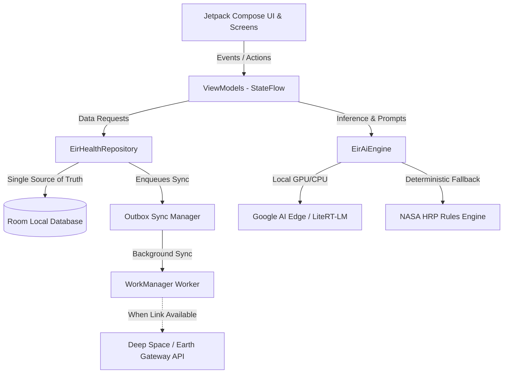

# 🚀 EIR (SOLIS) — NASA Space Apps Challenge

[](https://developer.android.com/)
[](https://kotlinlang.org/)
[](https://developer.android.com/jetpack/compose)
[](https://ai.google.dev/edge)
[](https://developer.android.com/training/data-storage/room)
[](https://github.com/Caryuter/nasa-space-app-challenge-eir-mobile/releases/latest)

> **EIR** es un copiloto médico y de bienestar autónomo diseñado para misiones de exploración en el espacio profundo (Luna y Marte), donde los retrasos en las telecomunicaciones (hasta 22 minutos por sentido) hacen imposible la telemedicina en tiempo real. 

EIR proporciona a los astronautas monitoreo biométrico multimodal, triaje de salud preventivo, seguimiento de hábitos y soporte conversacional con Inteligencia Artificial local **100% offline**, sin depender de la nube ni de servidores terrestres.

---

## 📱 Descargar APK

Puedes descargar la última versión compilada y lista para instalar directamente desde los **Releases de GitHub**:

📥 **[Descargar Eir-v1.0.0.apk](https://github.com/Caryuter/nasa-space-app-challenge-eir-mobile/releases/latest)**

*Requisitos: Android 8.0 (API 26) o superior.*

---

## ✨ Características Principales

### 1. 🧬 Captura Multimodal y Chequeo Diario Obligatorio (4 Pasos)
Flujo guiado para recolectar biomarcadores de forma no invasiva usando únicamente el hardware del smartphone:
- **Paso 1 — Escaneo Facial en Tiempo Real (CameraX):** Vista previa con guía anatómica para analizar signos visuales de microgravedad (redistribución cefálica de fluidos, edema periorbital y fatiga ocular).
- **Paso 2 — Prueba de Voz Guiada (AudioRecord):** Lectura de frase de calibración operacional para evaluar pausas respiratorias, fatiga vocal y estabilidad neuromuscular sin conexión.
- **Paso 3 — Signos Vitales Táctiles:** Controles steppers ergonómicos para pulso, presión arterial, temperatura y horas de descanso, acompañados de explicaciones cotidianas.
- **Paso 4 — Cuadrícula Emocional 2D:** Selector interactivo basado en el modelo Circumplejo de Russell (Ánimo vs. Energía) y chips de sensaciones operativas.

### 2. 🤖 Copiloto Conversacional con IA On-Device (Google AI Edge / LiteRT-LM)
- Inferencia de Lenguaje Natural (LLM) ejecutada localmente en la GPU/CPU del dispositivo móvil con **LiteRT-LM**.
- **Inyección de Contexto Local:** El copiloto conoce automáticamente los signos vitales recientes, sueño, hidratación y estado emocional del astronauta.
- **Motor de Respaldo Determinista:** Basado en el conocimiento y guías del *NASA Human Research Program (HRP)*, garantizando respuestas seguras y sub-segundo incluso si el modelo neuronal no está descargado.
- Acciones rápidas: *"Explícamelo aún más simple"* y *"Dame los pasos a seguir"*.

### 3. 🧍 Escaneo Anatómico Interactivo (Body Scan)
- Visualización interactiva del cuerpo humano (vista frontal y dorsal).
- Mapeo de síntomas por zonas (*Cabeza, Tórax, Abdomen, Extremidades*).
- Integración con cámara fotográfica para documentar lesiones tópicas o inflamación física localizada.

### 4. 🍎 Hábitos, Nutrición y Ejercicio Resistivo
- Seguimiento diario de hidratación por vasos de agua calibrados.
- Contador de calorías y desglose de comidas de misión.
- Cronometraje y registro de protocolos de ejercicio resistivo esenciales para contrarrestar la pérdida de densidad ósea y masa muscular en microgravedad.

### 5. 📖 Bitácora Emocional & Mascota Empática
- Registro personal de notas y reflexiones de misión.
- **Mascota Acompañante:** Reacciona dinámicamente al estado de salud y ánimo de la tripulación con animaciones y microcopy empático.
- Gráficos Sparkline para visualizar la evolución del estado anímico a lo largo de los Soles de misión.

### 6. 🚨 Modo de Emergencia SOS
- Interfaz aislada en rojo de alto contraste diseñada para situaciones de pánico o estrés crítico.
- **Instrucción única por pantalla:** Guía paso a paso en tamaño gigante.
- **Referencias visuales del botiquín médico:** Traduce insumos técnicos a descripciones prácticas (ej. *"Saca el estuche azul y coloca el oxímetro en el dedo índice"*).
- **Lectura por voz (Text-To-Speech nativo):** Lectura en voz alta para operar con las manos libres.

---

## 🎨 Filosofía de Diseño: "Cero Tecnicismos"

Siguiendo las directrices de factores humanos y habitabilidad de la NASA, EIR evita el estrés inducido por jerga médica compleja:
- **Ritmo del corazón** en lugar de *Frecuencia Cardíaca (BPM)*
- **Batería de tu cuerpo** en lugar de *Variabilidad de Frecuencia Cardíaca (HRV)*
- **Aire en tu sangre** en lugar de *Saturación de Oxígeno (SpO2)*
- **Fuerza de circulación** en lugar de *Presión Arterial (mmHg)*

Soporte completo bilingüe (**Español** e **Inglés**) con cambio dinámico del sistema.

---

## 🏗️ Arquitectura Técnica

EIR está construido siguiendo el paradigma **Offline-First**, donde la base de datos local SQLite (Room) es la **Única Fuente de Verdad (SSOT)**:



### Tecnologías & Librerías
| Componente | Tecnología |
| :--- | :--- |
| **Lenguaje** | Kotlin 2.0+ (Corrutinas, Flow, StateFlow) |
| **Interfaz de Usuario** | Jetpack Compose + Material Design 3 (Edge-to-Edge) |
| **IA en el Dispositivo** | Google AI Edge LiteRT-LM (`com.google.ai.edge.litertlm`) |
| **Base de Datos Local** | Room Database 2.6.1 + SQLite |
| **Cámara** | CameraX (Core, Camera2, Lifecycle, View) |
| **Sincronización en Fondo** | AndroidX WorkManager |
| **Red (Outbox Sync)** | Retrofit 2 + OkHttp 4 + Gson |
| **Voz / Audio** | Android AudioRecord + TextToSpeech (TTS) |

---

## 🛠️ Compilación y Desarrollo Local

### Prerrequisitos
- Android Studio Ladybug (2024.2+) o superior.
- Android SDK 35 / 37 (`compileSdk = 37`, `minSdk = 26`).
- JDK 11 o superior.

### Pasos
1. **Clonar el repositorio:**
   ```bash
   git clone https://github.com/Caryuter/nasa-space-app-challenge-eir-mobile.git
   cd nasa-space-app-challenge-eir-mobile
   ```

2. **Abrir en Android Studio:**
   Abre la carpeta del proyecto y espera a que Gradle sincronice las dependencias.

3. **Compilar el APK de Depuración (Debug):**
   ```bash
   ./gradlew assembleDebug
   ```

4. **Compilar el APK de Lanzamiento (Release firmado):**
   ```bash
   ./gradlew assembleRelease
   ```
   El archivo generado se ubicará en `app/build/outputs/apk/release/app-release.apk`.

---

## 👥 Equipo — NASA Space Apps Challenge

Desarrollado con dedicación por estudiantes de la **Universidad Tecnológica Emiliano Zapata del Estado de Morelos (UTEZ)** para el desafío global **NASA Space Apps Challenge**.

---

## 📄 Licencia

Este proyecto se distribuye bajo la licencia **MIT**. Consulta el archivo `LICENSE` para más detalles.
